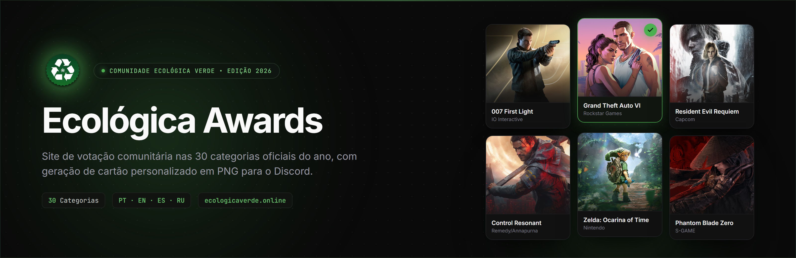

<p align="center">
  
</p>

<p align="center">
  
  
  
  
  
</p>

---

**Ecológica Awards** é a aplicação web de votação da comunidade **[Ecológica Verde](https://ecologicaverde.online/)**. Permite percorrer as 30 categorias oficiais da premiação, registrar um voto por categoria e exportar o resultado final como um cartão PNG com bordas arredondadas e fundo externo transparente — pronto para enviar no Discord.

Toda a votação, o perfil do usuário (avatar + username) e as preferências de idioma e áudio ficam salvos localmente no navegador, sem necessidade de conta ou backend.

---

## O que está incluído

- **30 categorias e 112 artes locais**: todas as categorias oficiais (jogos, atuação, criadores de conteúdo, atletas e times de esports) com as imagens salvas em `public/covers/` para carregamento imediato e exportação sem bloqueio de CORS.
- **Interface e micro-interações**: componentes no padrão `shadcn/ui` adaptados à paleta da Ecológica Verde (`#0a0a0a`, `#111111` e `#4caf50`), com spotlight dinâmico nos cards de categoria, inclinação 3D suave nos cards de votação e atalhos pelas setas `←` / `→`.
- **Perfil do Usuário e Cartão PNG**: upload de foto (redimensionada localmente para `256×256`) ou URL de avatar, nome de usuário exibido no cartão final e exportação em alta resolução (2x) recortada com cantos arredondados sobre fundo transparente.
- **4 idiomas integrados**: alternância instantânea no cabeçalho entre **Português (`PT`)**, **Inglês (`EN`)**, **Espanhol (`ES`)** e **Russo (`RU`)**, também acessível via URL (`?lang=en`, `?lang=es`, `?lang=ru`).
- **Player de trilha sonora**: reprodução contínua da faixa em `public/audio/theme.m4a` com controles discretos de play/pause, mudo e volume no canto inferior esquerdo.

---

## Estrutura do projeto

```text
.
├── .github/workflows/deploy.yml   # Deploy automático no GitHub Pages
├── docs/banner.png                # Banner do repositório
├── public/
│   ├── audio/theme.m4a            # Trilha sonora do site
│   ├── covers/                    # 112 capas e retratos oficiais
│   └── logo-ecologica.png         # Logo e favicon
└── src/
    ├── components/                # Views, cards, player de música e UI (shadcn)
    ├── data/categories.ts         # Definição das 30 categorias e indicados
    ├── i18n/                      # Traduções da interface e categorias (PT/EN/ES/RU)
    ├── lib/utils.ts               # Utilitário de classes (clsx + tailwind-merge)
    └── types/awards.ts            # Tipagens TypeScript
```

---

## Personalização rápida

| O que alterar | Onde editar |
| --- | --- |
| Categorias, indicados ou ano da edição | `src/data/categories.ts` |
| Traduções (`PT`, `EN`, `ES`, `RU`) | `src/i18n/translations.ts` e `src/i18n/categoryTranslations.ts` |
| Trilha sonora | Substituir `public/audio/theme.m4a` |
| Logo do projeto | Substituir `public/logo-ecologica.png` e `src/assets/logo-ecologica.png` |
| Paleta e tokens visuais | `src/index.css` |

---

<p align="center">
  <sub>Ecológica Awards – 2026 • <a href="https://ecologicaverde.online/">ecologicaverde.online</a></sub>
</p>
